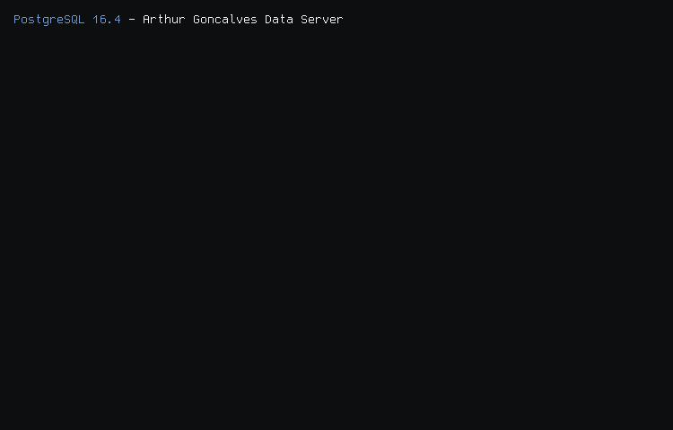

<!--START_SECTION:terminal-->
<picture>
    <source media="(prefers-color-scheme: dark)" srcset="./output.gif">
    <source media="(prefers-color-scheme: light)" srcset="./output.gif">
    
</picture>

 
<!--END_SECTION:terminal-->

Data Engineering • SQL • ETL • Data Modeling • Databricks • Medallion Architecture

Sou o **Arthur**, tenho 25 anos, moro em Belo Horizonte e estou construindo minha carreira em **Engenharia de Dados**: gosto de pegar dado bruto, organizar em camadas e entregar algo confiável para quem vai consumir.

* Estudante de **Engenharia de Software** na [PUC Minas](https://www.pucminas.br/) (5º período).
* Trabalho principalmente com **SQL**, **Python** e **PySpark** no **Databricks**.
* Organizo dados na **arquitetura Medallion** (Bronze → Silver → Gold), com processos de **ETL**, ingestão e transformação.
* Interessado em **modelagem de dados**, **qualidade e consistência** dos dados e boas práticas de pipeline.
* Também desenvolvo com **Java**, **JavaScript**, **React**, **Vue.js** e **Node.js**.
* Portfólio: [arthurgoncalves.vercel.app](https://arthurgoncalves.vercel.app)
* LinkedIn: [in/arthur-goncalves-62b15232a](https://www.linkedin.com/in/arthur-goncalves-62b15232a/)
* Email: [arthurgvkj@gmail.com](mailto:arthurgvkj@gmail.com)

### Tech Stack

**Dados**

**Desenvolvimento**

**Ferramentas**

<strong>Estatísticas</strong>

 

  
    
  
  
    
  

